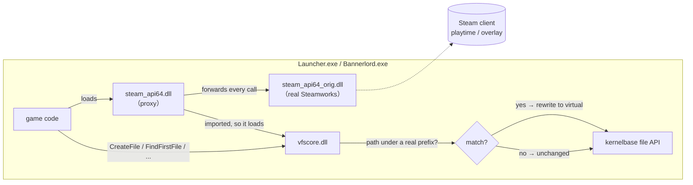

# GameIsolatorVFS

Give one Steam game install its **own private user-data folders** — saves, configs,
mod lists — while Steam still sees and times the normal game. Nothing is moved,
no junctions, no second Steam entry. A heavily-modded copy lives happily next to a
clean one, each with completely separate `Documents` / `ProgramData`.

It does this by redirecting the Win32 file APIs *inside that one game's processes*:
any path under a folder you list gets transparently rewritten to a folder inside
the game install. The launcher and the game are both covered.

Built originally to isolate a 1.4.x *Mount & Blade II: Bannerlord* install running a
total-overhaul mod, but it is game-agnostic.

---

## The problem

Many games hard-code their user data to a shared location:

```
%USERPROFILE%\Documents\<Game>\        <- saves, Configs, LauncherData.xml, MCM settings
%ProgramData%\<Game>\                  <- crash logs, shader cache
```

Two installs of the same game share that one folder. Install a big overhaul in copy
B and it clobbers copy A's configs and fills the save list with saves vanilla can't
load. There is usually **no launch flag** to move this folder, and the obvious
workarounds are all bad:

* **Junctions / folder swapping** — you have to swap the shared folder around every
  launch; a crash leaves it pointing at the wrong place.
* **A non-Steam shortcut** — then playtime/achievements track under the shortcut, not
  the game.
* **`version.dll` / `winmm.dll` proxy** — fails, because a copy of those lives in
  `System32` and gets loaded into the process *before* the game-folder copy is ever
  looked at, so the game-folder copy is ignored.

## The approach

Two pieces:

1. **A proxy for a DLL the game loads only from its own folder.** `steam_api64.dll`
   is loaded early by both the launcher and the game, exists **only** in the game
   folder (no `System32` twin to shadow it), and has no reason not to be hijacked.
   We rename the real one to `steam_api64_orig.dll` and drop in a generated proxy
   that forwards **every** export to the original — so Steam init, playtime, overlay
   and achievements are completely unchanged — and, as a side effect of being
   loaded, pulls in the redirector.

2. **A filesystem redirector (`vfscore.dll`).** Once in the process it hooks the
   Win32 path-taking file APIs (`CreateFileW`, `CreateDirectoryW`, `FindFirstFileW`,
   `GetFileAttributesW`, `MoveFileExW`, `CopyFileW`, … 19 in total, plus key ANSI
   variants) via [MinHook](https://github.com/TsudaKageyu/minhook). For every call it
   checks the path against your configured *real → virtual* prefix pairs and rewrites
   matches before the real API sees them. Everything else passes through untouched.

Because the interception is at the actual filesystem call — not at
`SHGetFolderPath` — it does not matter how the program built the path or whether it
cached it. The launcher's `Documents\<Game>` write lands in your virtual folder just
like the game's does.



---

## Requirements

* 64-bit Windows game that ships `steam_api64.dll` (most modern Steam games).
* **Python 3** (standard library only) to run the installer — or just do the three
  file operations by hand. Nothing is compiled or generated on your machine; the proxy
  ships prebuilt.
* 32-bit games use `steam_api.dll` and would need a 32-bit `vfscore` — not built here,
  open an issue if you want it.

## Install

1. **Edit `vfsproxy.ini`** (copy it from `vfsproxy.ini.example`). Set the real → virtual
   folder pairs you want redirected — see [Configuration](#configuration).
2. Copy **`vfsproxy.py`**, **`steam_api64.proxy.dll`**, **`vfscore.dll`** and your
   **`vfsproxy.ini`** into the game's binary folder, next to its `steam_api64.dll`.
   For Bannerlord that is:
   ```
   ...\Mount & Blade II Bannerlord\<YourInstall>\bin\Win64_Shipping_Client\
   ```
3. From that folder, run:
   ```
   python vfsproxy.py
   ```
   This renames the real `steam_api64.dll` → `steam_api64_orig.dll`, drops in the
   prebuilt `steam_api64.proxy.dll` as `steam_api64.dll`, and places `vfscore.dll`
   beside it. (You can also do these three file operations by hand — no Python needed.)
4. Launch the game normally (through Steam, the launcher, or the game exe). Both the
   launcher and the game are now redirected.

Re-running `vfsproxy.py` is safe and idempotent: if `steam_api64_orig.dll` already
exists it just refreshes the proxy and `vfscore.dll`. If Steam ever restores the
original `steam_api64.dll` (e.g. after *Verify integrity of game files* or a game
update), run it again.

## Configuration

`vfsproxy.ini` lives next to `vfscore.dll`. Pair the paths by number; use full absolute
paths with no trailing slash.

```ini
[settings]
hijack_dll  = steam_api64.dll   ; the folder-only DLL to proxy
create_dirs = 1                 ; create each virtual root at startup
log         = 1                 ; write vfsproxy.log next to this file (set 0 when happy)

[paths]
Path1Real    = C:\Users\YOU\Documents\Mount and Blade II Bannerlord
Path1Virtual = E:\SteamLibrary\steamapps\common\Mount & Blade II Bannerlord\TalesAge\MyDocs

Path2Real    = C:\ProgramData\Mount and Blade II Bannerlord
Path2Virtual = E:\SteamLibrary\steamapps\common\Mount & Blade II Bannerlord\TalesAge\MyProgramData

; add as many pairs as you like
; Path3Real    = C:\Users\YOU\AppData\Roaming\SomeGame
; Path3Virtual = E:\...\ThisInstall\MyAppData
```

* Only the exact prefixes you list are touched. Steam's own files and the rest of the
  game install pass through unchanged.
* Matching is case-insensitive and `\`/`/`-insensitive, boundary-aware (so
  `...\Bannerlord` does not accidentally match `...\Bannerlord Tools`).
* To carry over existing settings, copy your current `Documents\<Game>\Configs` into the
  `Path1Virtual` folder before first launch. Otherwise the game starts fresh.

## Verify

`vfsproxy.log` (next to `vfscore.dll`) shows, per process:

```
attach TaleWorlds.MountAndBlade.Launcher.exe: 19 hooks (0 failed) enabled, 2 path pair(s)
  [1] C:\Users\...\Documents\Mount and Blade II Bannerlord  =>  E:\...\TalesAge\MyDocs
h_CreateFileW -> E:\...\TalesAge\MyDocs\...\Configs\LauncherData.xml
```

You want an `attach` line for **both** `...Launcher.exe` and `Bannerlord.exe`. Toggle a
mod in the launcher and confirm `LauncherData.xml` updates under your virtual folder and
**not** under the real `Documents`.

## Revert

Delete `steam_api64.dll` and `vfscore.dll`, rename `steam_api64_orig.dll` back to
`steam_api64.dll`, and remove `vfsproxy.ini` / `vfsproxy.log`.

---

## How the proxy works

`steam_api64.proxy.dll` (`proxy.c` + `steam_api64.def`) is a compiled forwarder DLL:

* **Export table:** one forwarder per Steamworks export, `Name → steam_api64_orig.Name`,
  preserving names and ordinals. Windows resolves forwarders lazily, so exports missing
  from a given `_orig` never cause a failure unless actually called. Steam init, playtime,
  overlay and achievements run through the real DLL unchanged.
* **Import:** it statically imports `vfscore.dll!VfsInit`. That is the trick that loads the
  redirector — when the loader binds the import it loads `vfscore.dll`, whose `DllMain`
  spawns a worker thread that installs the file-API hooks.

`vfscore.c` is the redirector: config parsing, prefix remap, and the MinHook installs. The
hooks are installed from a worker thread, **not** from `DllMain` — MinHook suspends threads
to patch, which faults under the loader lock on real Windows.

> An earlier version generated the proxy PE in pure Python (no compiler). Convenient, but
> the hand-built PE was rejected by the real Windows loader (`0x800701E7`), so the project
> ships a normal **compiled** proxy instead.

The shipped proxy is built from a recent Steamworks export set, which covers current games.
If a game's `steam_api64.dll` has exports the proxy doesn't, rebuild it from that DLL — the
export-dump one-liner and build steps are in [`build.sh`](build.sh).

## Building from source

The repo ships prebuilt 64-bit `vfscore.dll` and `steam_api64.proxy.dll`, so you need no
toolchain to use it. To rebuild both (Linux cross-compile or an msys2 mingw64 shell on
Windows):

```sh
./build.sh      # clones MinHook, builds vfscore.dll and steam_api64.proxy.dll
```

Needs `mingw-w64` (Debian/Ubuntu: `apt install mingw-w64`). To retarget the proxy to a
different game's `steam_api64.dll`, regenerate `steam_api64.def` from that DLL first — the
`pefile` one-liner is at the top of `build.sh`.

---

## Notes & caveats

* **Not malware.** `vfscore` hooks file APIs *inside the game's own processes* to remap a
  handful of paths you configure; the Steamworks proxy forwards every call to the real DLL
  untouched. It does not phone home, modify Steam, or touch anything outside the folders you
  list. Source is here; read it.
* **Antivirus** sometimes flags unsigned DLLs that install API hooks. If `vfscore.dll`
  disappears, whitelist the folder.
* **Steam → Verify integrity of game files** restores the original `steam_api64.dll`; just
  run `vfsproxy.py` again afterwards.
* **Online / anti-cheat games:** intended for singleplayer / offline modded installs. Do not
  use with kernel-anti-cheat or competitive online games.
* 64-bit only (see Requirements).

## License

MIT — see [LICENSE](LICENSE).
